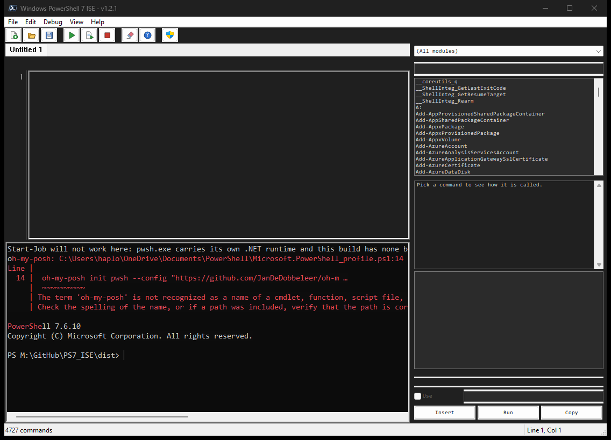

# PS7 ISE

An open-source clone of the Windows PowerShell ISE (`powershell_ise.exe`) that runs
**PowerShell 7** instead of Windows PowerShell 5.1. The front-end is Rust on native Win32
controls; the shell itself runs in a child .NET process that hosts a real `PSHost` and
runspace. The UI follows the operating system's theme (including Dark mode), and the console
pane behaves like a console: prompt, inline output, colours, history, `Ctrl+C`, and Tab
completion from the shell's own `TabExpansion2`.

[Support Me on Patreon](https://patreon.com/haplopeart?utm_medium=unknown&utm_source=join_link&utm_campaign=creatorshare_creator&utm_content=copyLink).



The window is the original ISE arrangement: menu bar, toolbar, a tabbed script pane on
top, the console pane below it, the Commands column down the right-hand side, and a status bar
showing the current location. The panes and the right-hand column resize with the window to
make the most of the screen.

## Install

Run `PS7ISE-Setup.exe` from the
[latest release](https://github.com/haplopeart/PS7_ISE/releases/latest). It asks for
elevation, installs to `C:\Program Files\HCW\PS7ISE`, puts `HCW\PS7 ISE` in the Start Menu
with a desktop shortcut, and registers an uninstaller in Add/Remove Programs. Nothing has to
be installed first: the installer carries the .NET runtime.

To build the installer yourself you need [NSIS](https://nsis.sourceforge.io/Main_Page):

```powershell
.\build.ps1 -SelfContained -OutDir dist-setup      # the payload the installer packages
makensis /DPAYLOAD=dist-setup PS7ISE-Installer.nsi # -> PS7ISE-Setup.exe
```

## Requirements

| | To build | To run `dist` |
| --- | --- | --- |
| Windows | x64 | x64 |
| Rust | stable toolchain with the MSVC builder | — |
| .NET | SDK 10.0 or newer | .NET runtime of the generation the pinned PowerShell targets (.NET 10 for PowerShell 7.6) |

`build.ps1 -SelfContained` bundles the .NET runtime into the output folder, which removes the
.NET requirement on the machine that runs it, at the cost of a much larger folder - 37 MB
becomes about 113 MB. The committed `dist` is the small build; the release installer packages
a self-contained one, because `Start-Job` only works from a folder that carries the runtime
(see [Known limitations](#known-limitations)).

## Build

`dist\` is committed, so a fresh clone is runnable as it is: start `dist\PS7_ISE.exe` and
the console pane comes up on the PowerShell pinned in the csproj. To rebuild after changing
anything:

```powershell
.\build.ps1                 # engine + front-end into .\dist
.\build.ps1 -SkipEngine     # front-end only (leaves the published engine alone)
.\build.ps1 -SkipFrontEnd   # engine only (keeps the PS7_ISE.exe already in dist)
.\build.ps1 -SelfContained  # ship the .NET runtime in dist (about 114 MB)
```

Then run `dist\PS7_ISE.exe`. The engine files have to stay next to the exe: PowerShell
derives `$PSHome`, and therefore `$PSModulePath`, from the folder containing
`System.Management.Automation.dll`, so `dist\Modules\` is what makes the bundled cmdlets
load.

Scripts open from the command line as well - `dist\PS7_ISE.exe demo.ps1` starts with that
file in the script pane - or from File > Open Script, `Ctrl+O`, inside the app.

## Which PowerShell you get

The version is pinned by one property in
`PowerShellEngineHost\PowerShellEngineHost\PowerShellEngineHost.csproj`:

```xml
<PowerShellVersion>7.6.10</PowerShellVersion>
<TargetFramework>net10.0</TargetFramework>
```

`Microsoft.PowerShell.SDK` **is** the PowerShell that runs - the app never looks for an
installed `pwsh.exe`, so what you build is what you get. The banner in the console pane is
`$PSVersionTable.PSVersion` read straight out of that assembly, and `$PSHome` points at
`dist`. Check it with `$PSVersionTable` at the prompt.

The goal is the newest stable release on the newest .NET it supports. A brand new minor
release is deliberately left alone until it has had a few patches - `7.7.0` is skipped for
now, on the grounds that Microsoft finds bugs faster than anyone else does.

To move to another release, raise `PowerShellVersion` and set `TargetFramework` to the
framework that release is built for - `net8.0` for 7.4, `net9.0` for 7.5, `net10.0` for
7.6. `build.ps1` finds the module folder by pattern, so nothing else refers to the
framework.

## Console keys

| Key | Effect |
| --- | --- |
| `Enter` | submit the line |
| `Tab` | completions from `TabExpansion2`; repeated Tab cycles the candidates |
| `Up` / `Down` | command history |
| `Ctrl+C` | copy the selection if there is one, otherwise stop the running command / abandon the line |
| `Ctrl+V`, `Ctrl+A`, `Esc` | paste, jump to the start of the line, clear the current line |
| `PgUp` / `PgDn` | scroll the scroll-back |
| `F5` / `F8` | run the script pane / run the selected lines |
| `F1` | PowerShell 7 help |
| `Ctrl+N` `Ctrl+O` `Ctrl+S` `Ctrl+Shift+S` `Ctrl+W` | new, open, save, save as, close the script tab |

## Commands pane

The column down the right-hand side is the original ISE's Commands add-on: it lists what the
session can run and builds a command line out of the ones you tick.

| Part | What it does |
| --- | --- |
| Module | Filters the list to one module. `(All modules)` is the whole session, `(no module)` the commands that own no module - the drive roots like `A:` and the functions the session defines itself |
| Find | Substring match on the name, applied as you type. The selection follows the command, so the list can be rebuilt on every keystroke without losing where you were |
| Command list | The cmdlets and functions the session knows, alphabetical. Double-click a name to insert it where the caret is |
| Syntax | Where the command came from, what it is for, and how it is called - one line per parameter set |
| Parameter list | `[x]` against the parameters to use, and `*` against one the command cannot be run without. The parameters every cmdlet has (`-Verbose`, `-ErrorAction`, ...) are sorted to the bottom under a divider, because the original ISE kept them on a tab of their own |
| `Use`, and the box beside it | Apply to the parameter the list has selected: tick it to put it on the command line, type its value in the box. A switch has no value, so the box is greyed out for one |
| **Insert** | Writes the command line at the caret - the console prompt, or the script pane when that is what has the focus |
| **Run** | Submits it now |
| **Copy** | Puts it on the clipboard |

Parameters are always written by name, never positionally, so a command line that has been
through the script pane still says which value belongs to which parameter.

View > **Show Commands Column** gives the width back to the two panes. View > **Refresh
Command List** reads the session again instead of answering from what the pane already has,
which is how the commands of a module you imported since opening the app make their way into
the list.

Selecting a command imports its module, exactly as picking one in the original ISE did. That
is the only way to get a command's parameters at all: the list itself is read without
importing anything, which is why four thousand commands arrive in about a second, and a
command from a module nobody has loaded is a name with nothing else to say about itself.

## How it works

```
PS7_ISE.exe  (Rust, native-windows-gui)
    |  writes:  L <line>  T <caret> <text>  S  X   M i   M r   M d <name>
    |  reads:   E <kind> <fg> <bg> <text>   C <count> <text>   Q <code>
    |           M <kind> <part> <of> <reply> <payload>
    v
PowerShellEngineHost.exe  (.NET, Microsoft.PowerShell.SDK)
    Program.cs          the protocol
    ISEHost.cs          PSHost + PSHostRawUserInterface
    Session.cs          the runspace, the prompt loop, TabExpansion2
    CommandMetadata.cs  the command list, and one command's parameters
```

`M` is the metadata verb: `i` for the list of commands, `d <name>` for one command, `r` to
throw the cached list away. An answer arrives in chunks of 48 KB that are numbered, so a
command finishing in the middle of a list cannot splice its output into the middle of a
reply. It is answered only while the shell is idle - while a command is running the engine
says so in one line, and the pane asks again a moment later rather than counting the refusal
as a failure.

One record per line, with text escaped to printable ASCII (`\\`, `\uXXXX`), so nothing a
command prints can break the framing. The Rust side keeps the console document in memory -
scroll-back plus the line being typed - and pushes it into the rich edit control once per
timer tick. Colour is remembered as runs and replayed with `EM_SETCHARFORMAT` after each
refresh, because the one write the control reliably accepts, `WM_SETTEXT`, carries plain
text only.

The engine is a separate process on purpose: hosting .NET in-process through `hostfxr`
needs `load_assembly_and_get_function_pointer`, and every entry point that touches
`Microsoft.PowerShell.SDK` fails to resolve (`0x80131509`). Native AOT is not an option
either - `System.Management.Automation` reflects over itself and dies at the first
pipeline. A child process also means a runaway command cannot take the UI down with it.

## Debugging

- `PS7ISE_DEBUG=1` traces engine events to `%TEMP%\ps7ise.log`, and makes the app replay
  whatever is written to `%TEMP%\ps7ise-inject.txt` as keystrokes - the way automated tests
  drive the prompt, since Windows refuses to deliver input posted by another process to a
  window without the keyboard focus. `{MENU:n}` in that file runs the menu command with id
  `n` (see `state::cmd`), which covers the entries that have no key of their own.
- The engine's own stderr goes to `%TEMP%\ps7ise-engine.log`.

## Repository layout

| Path | Contents |
| --- | --- |
| `src\main.rs` | window, menus, toolbar, layout, timer pump, shortcuts |
| `src\state.rs` | application state, console document and colour runs, engine pump |
| `src\console.rs` | the console rich edit control: text, selection, colours, caret |
| `src\input.rs` | console keystrokes, history, completion insertion, clipboard |
| `src\commands.rs` | the `M` answers: reassembly, parsing, what the Commands pane knows |
| `src\panel.rs` | the Commands column: its controls, its filters, Insert / Run / Copy |
| `src\docs.rs` | script tabs, file I/O, "run this in the console" |
| `src\highlight.rs` | PowerShell syntax colouring for the script pane |
| `src\engine.rs` | the child process and its record protocol |
| `PowerShellEngineHost\` | the .NET engine |
| `build.ps1` | publishes the engine, flattens its modules, builds the front-end |

## Known limitations

- Windows x64 only.
- No script debugger: no breakpoints, no stepping, no variable inspection. The Debug menu
  holds only the three commands it can really perform - Run Script, Run Selection, Stop Run.
- Panes split at a fixed ratio and there is no draggable splitter bar; View > Show/Hide
  switches between one pane and two.
- The command list font is fixed at two points larger than 1.0.9 for readability.
- The user's PowerShell profile (`$PROFILE`) is loaded at startup. A custom `prompt` function
  will be used, but oh-my-posh and other ANSI themes are stripped of their escapes (the console
  is rich text, not a terminal).
- Modules that are known not to load in PowerShell 7 are filtered out of the Commands panel.
  Verdicts are logged to the debug log (`PS7ISE_DEBUG=1`).

- The console scroll-back is trimmed once it passes about 400 000 characters, and every
  refresh rewrites the document, which a normal session never notices but a command
  printing hundreds of megabytes will.
- A `Write-Progress` bar cannot redraw itself in a text document, so each update prints a line
  of its own. The record whose only job is to erase the bar prints nothing at all, which is
  also what stops a finished command from repeating the prompt.
- Windows PowerShell 5.1 is deliberately not supported.
- `Start-Job` needs a self-contained build. A background job is a second PowerShell started
  at `$PSHome\pwsh.exe`, `pwsh.exe` looks for its runtime only in its own folder, and
  `$PSHome` is read-only, so the runtime has to be beside the engine. The release installer
  ships such a build; `.\build.ps1` without `-SelfContained` prints a notice at startup and
  leaves jobs unavailable.
- The Commands pane reads metadata only while the shell is idle: the runspace answers one
  thing at a time, so asking about commands while a command is running gets a one-line
  refusal, and the pane waits and asks again rather than treating that as a failure.
- The command list is a snapshot taken when the pane is opened, so a module imported later
  stays out of it until View > Refresh Command List.
- Help text is only there when the module's help is installed. Without it a parameter still
  reports its type, whether it is required, its position and whether it is a switch, but no
  description, and the summary line is the one PowerShell makes up from the syntax.
- For a function, the syntax area shows what `Get-Command` calls its definition, which for a
  function is its body. For a cmdlet the same field holds its parameter sets, which is what the
  area is laid out for.

## License

MIT.

## Changelog

### 1.1.0
- The GUI follows the OS theme, including Dark mode.
- Panes and the command list column resize with the window.
- The command list font is larger and more readable.
- The user's PowerShell profile (`$PROFILE`) is automatically loaded.
- Command prompt colours are preserved and no longer inherited from the previous output.
- Modules that fail to load in PowerShell 7 are automatically excluded from the command list,
  with the reason for failure logged in the debug console.
- Minor installer and versioning corrections.

### 1.0.9
- Commands panel implemented.
